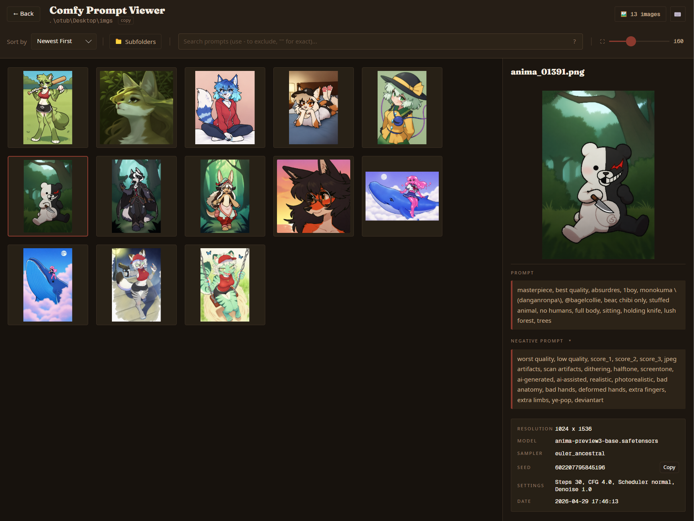

# ComfyPromptViewer

ComfyPromptViewer is a local desktop app for browsing AI image output folders and viewing the prompts and generation settings saved inside image files.

It supports images from ComfyUI, Forge Neo, Draw Things, and Stable Diffusion WebUI/A1111-style metadata, plus ComfyUI MP4 video output.



## Features

- Browse large folders of generated images in a virtualized, adjustable-size grid, optionally including subfolders.
- View prompts, negative prompts, image dimensions, models, samplers, seeds, tool hints, LoRAs, extra resources, and common generation settings.
- Search filenames, positive prompts, negative prompts, or all metadata with exact phrases and exclusions; matching terms are highlighted in the sidebar prompts.
- Click a model, sampler, seed, or LoRA in the sidebar to add it to the search and find other images that share it.
- Copy positive and expanded negative prompts from dedicated sidebar buttons; very long positive prompts collapse behind a fade and can be expanded.
- Open a zoomable, pannable preview and move between images without closing it; the previous image stays visible while the next loads in the background.
- MP4 videos play in the large preview with sound, a pause button, a timeline to scrub, mute, and volume; they are marked with a play badge in the gallery. Prompts saved by Save Video and VideoHelperSuite Video Combine (MP4 formats) are read, as are Save Animated WEBP prompts.
- Right-click gallery cards or the large preview to copy prompts, negative prompts, or image paths; open the file location; or delete the image.
- Multi-select cards to copy their positive prompts together or delete them as one confirmed batch.
- Sort by date or filename, switch color themes, and quickly reopen recent folders.
- Pin favorite folders to the top of the recent list; up to 25 unpinned folders are kept, and folders that can't be found (like an unplugged drive) are dimmed rather than removed.
- Consistent vector toolbar and menu icons on Windows and Linux, with readable secondary text across all five themes.
- Drag the divider to resize the metadata sidebar; window size, position, and sidebar width are remembered between runs.
- Watch the active folder for created, modified, renamed, or removed images.
- Cache thumbnails and parsed metadata locally for faster repeat browsing, optionally caching the whole folder's thumbnails in the background, starting from wherever you are scrolling.
- Clear cached thumbnails for just the folder you are viewing, or for every folder at once.

## Search Syntax

- Separate terms with spaces, commas, or semicolons.
- Use `-term` or `-"exact phrase"` to exclude matches.
- Put a term in quotes for an exact word or phrase: `"red dress"`.
- Use the scope selector to search all metadata, positive prompts, negative prompts, or filenames only.
- Opening a different folder clears the search; reloading or reopening the same folder keeps it.

Examples:

```text
portrait cinematic -watermark
"red dress" -"blurry background"
```

## Keyboard and Mouse Controls

- Arrow keys, `Home`, and `End`: navigate the gallery or large preview.
- `Ctrl+click`: toggle a card in the selection; `Shift+click`: select a range.
- `Space`, `Enter`, or double-click: open the selected image preview.
- `Esc`, `Space`, or `Enter`: close the large preview. On a video, `Space` pauses instead and `M` mutes.
- Mouse wheel: scroll the gallery; zoom the large preview.
- Pinch on a trackpad or touchscreen: zoom the large preview.
- Drag in the large preview: pan a zoomed image.
- Middle-click in the gallery: start autoscroll.
- `Ctrl+C` in a sidebar prompt: copy the selected text.
- Click a sidebar model, sampler, seed, or LoRA: add it to the search.

## Getting Started

### Download a Release
Download the latest self-contained packaged build from the [GitHub Releases page](https://github.com/0tub/Comfy-Prompt-Viewer/releases). Packaged builds do not require a separate .NET installation.

### Video Support

MP4 thumbnails and playback use the VLC already installed on your system, so the app does not bundle a video decoder. Without VLC, MP4 files still appear with their prompts and metadata, but have no thumbnail or playback.

- **Windows**: install 64-bit [VLC](https://www.videolan.org/vlc/) 3.x from the official installer (the default download). The 32-bit build and portable copies are not found.
- **Linux**: install your distribution's `vlc` package (`sudo dnf install vlc` on Fedora, `sudo apt install vlc` on Debian/Ubuntu). It brings the codec and audio plugins the library alone lacks. Flatpak and Snap VLC do not work, because they keep libvlc inside their sandbox.
- **macOS**: not supported.

### Run from Source

Prerequisite:

- [.NET 10 SDK](https://dotnet.microsoft.com/download/dotnet/10.0)

```powershell
dotnet run --project src\ComfyPromptViewer\ComfyPromptViewer.csproj
```

### Low-Memory Mode

Turn on **Low-memory rendering** under the menu's Advanced Maintenance section (takes effect after a restart), or set `COMFYPROMPTVIEWER_SOFTWARE_RENDERING=1` before launching, to render on the CPU instead of the GPU. On Linux this used about 100 MB less memory in testing, at the cost of more CPU while scrolling.

### Build Standalone Executables
- **Windows**: Run `.\publish.ps1` (outputs `src\ComfyPromptViewer\bin\Release\net10.0\win-x64\publish\ComfyPromptViewer.exe`)
- **Linux**: Run `./publish.sh` (outputs `src/ComfyPromptViewer/bin/Release/net10.0/linux-x64/publish/ComfyPromptViewer`)

### Checks

```powershell
dotnet test
```

## License

This project is licensed under the [MIT License](LICENSE).

Third-party license notices are listed in [THIRD-PARTY-NOTICES.md](THIRD-PARTY-NOTICES.md).
